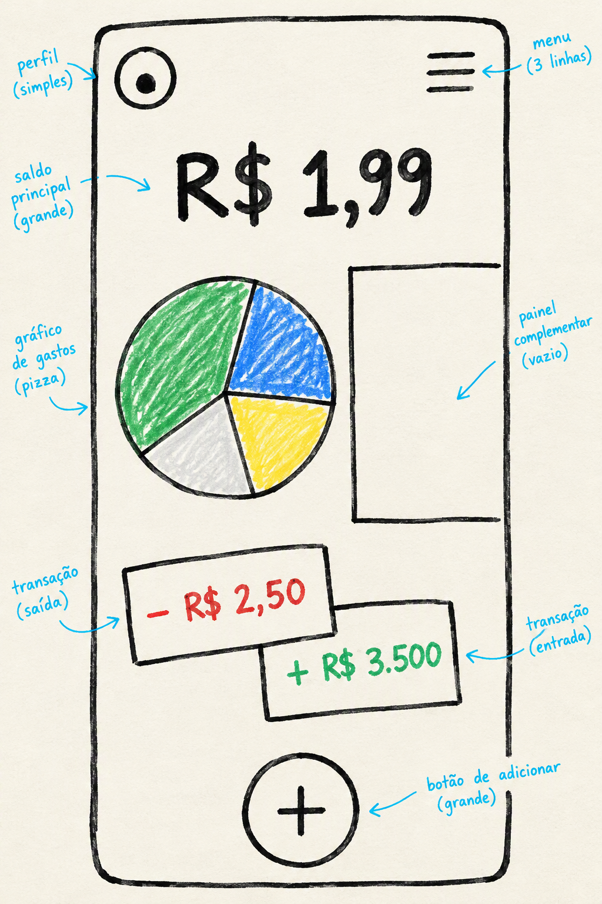

# Dashboard - prototipo de baixa fidelidade

## Estrutura representada

- Foto de perfil no canto superior esquerdo
- Menu hambúrguer no canto superior direito
- Saldo destacado em `R$ 1,99`
- Grafico de pizza exclusivo para despesas
- Painel complementar reservado ao lado do grafico
- Saida destacada em vermelho: `- R$ 2,50`
- Entrada destacada em verde: `+ R$ 3.500`
- Botao circular de nova transacao com o simbolo `+`

O painel complementar permanece sem conteudo definido neste wireframe.